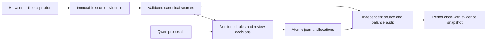

# Pacioli: accounting integrity review and remediation vision

Review date: September 26, 2026. Scope: the current working tree, including its
existing uncommitted work; HEAD is `4a66ed8`, which alone does not describe the
reviewed implementation. This review changes no application behavior or live
financial records.

## Assessment

Pacioli has useful foundations: exact decimal amounts, encrypted source evidence,
replay checks in the newer QFX importer, journal mutation records, period locks,
and a separation between model proposals and reviewed posting. The main problem
is inconsistent enforcement across entry points. Older ingestion and mapping
paths bypass protections that newer workflows provide, while the independent
audit cannot reliably detect the resulting omissions and mispostings.

A balanced trial balance, matching ending balance, or clean current audit is
therefore insufficient evidence that all economic activity was correctly booked.
This is a demonstrated limitation of the checks, not a finding that the owner's
live books contain the synthetic defects below.

The five priorities were selected by consequence, reachability, and reproducible
evidence. P1 means a high-priority correctness defect; P2 means a material control
gap with more limited current exposure. No production incident is asserted.

| Rank | Priority | Issue | Confirmed consequence |
| --- | --- | --- | --- |
| 1 | P1 | Audit and close omit source coverage and signed posting checks | Two unposted transactions pass audit and a month closes with zero journals |
| 2 | P1 | Concatenated source identifiers collide | Two distinct sources appear booked by one journal |
| 3 | P1 | Legacy OFX sync bypasses validated ingestion | EUR is treated as USD; changed records are silently ignored; rejected sync leaves committed sources |
| 4 | P1 | Competing mappings are resolved by execution order | The same purchase and rules produce different expense categories |
| 5 | P2 | Database conversion constraints accept incomplete evidence | A foreign-currency journal without a rate commits and passes audit |

## 1. Audit and period close can certify incomplete or misposted books

**Code:** `pacioli/functions/accounting_report.py:194–214,304–351`;
`pacioli/functions/period_close.py:89–109`;
`pacioli/functions/journal_posting.py:42–101`.

`source_differences()` begins with existing journal entries, so imported sources
with no journal are absent from its comparison. It compares summed functional
amounts to the absolute source amount. It does not prove that the correct bank
account moved in the correct direction on the correct date. `post_pair()` checks
account currency but likewise does not validate that complete source relationship.
Aggregate balance checks cannot detect offsetting mistakes.

**Reproduced:** import synthetic sources of +100 and -100 with a zero bank
balance, create no journals, and the full audit returns no issues. January closes
with zero journals. A second reproduction posts both sources with reversed bank
directions and incorrect dates; the full audit still reports no issues.

**Fix:** define a source-to-posting contract. Every accepted source must have a
complete, conserved allocation or an explicit unresolved state. For bank cash
movements, independently compare signed ledger effect, bank account, posting date
under a documented date policy, source currency, and allocation total against the
original normalized source. Distinguish primary cash sources from supporting
receipt evidence so Amazon allocations do not create a second cash movement.
Legitimate date adjustments or provider corrections need explicit linked evidence.

Build audit from the complete source population, not just existing journals.
Reuse its findings to enforce posting, but keep the independent checker capable
of detecting invalid direct database writes. Make month-close readiness cover all
relevant sources and evidence through its cutoff. Keep global health separate:
the current global audit also lets later suspense block an otherwise clean earlier
month. Closing should retain source/coverage evidence as well as a journal digest,
so a later backdated import invalidates readiness instead of remaining invisible.

**Acceptance tests:** offsetting omissions; wrong bank account, sign, or date;
partial and excessive allocations; missing supporting evidence; late backdated
sources; linked reversals and reviewed adjustments; transfers across month-end;
future versus in-period suspense; timezone boundary transactions; simultaneous
close and import. Tests must show the specific source and invariant that failed,
not merely a different aggregate balance.

## 2. Source identity is ambiguous across accounts

**Code:** `pacioli/database/sql_views.py:269,290,412`;
`pacioli/models.py:720–722`;
`pacioli/functions/journal_posting.py:15–23`.

The derived identifier is `concat(fitid, acctfrom_id)`. For example, FITID `1` in
account `23` and FITID `12` in account `3` both become `123`. Although underlying
OFX rows have distinct composite keys, the ORM treats the derived value as a sole
primary key and posting joins use it as source identity.

**Reproduced:** two raw source rows survive, but the ORM query returns one
transaction. Creating one journal makes both source rows report that journal as
their posting. This can hide missing activity, misassociate evidence, and make
replay checks falsely conclude that a transaction was already handled.

**Fix:** introduce a stable internal source-transaction identifier with an enforced
unique provider/account/FITID key. Give journal allocations an explicit foreign-key
association with that source. Preserve raw provider identifiers and source-file
provenance separately. Do not use presentation strings as database identities.

Before migration, inventory all collisions and references. Build an explicit
legacy-to-canonical identity bridge and stop on ambiguous references rather than
selecting the first match. Preserve closed journals, existing evidence digests,
and historical identifiers through that bridge; any necessary financial
correction must be a separately reviewed operation, not a side effect of changing
keys. Merely adding a delimiter to future imports would leave old references
broken and create replay duplicates.

**Acceptance tests:** actual concatenation collisions; identical FITIDs on
different accounts; either account/import order; split allocations; exact and
overlapping replay; migration of unambiguous references; rejection of ambiguous
references; migration rollback/retry. Compare source counts, financial totals,
journal associations, retained evidence, and closed-period verification before
and after migration.

## 3. Legacy OFX sync has a weaker financial trust boundary

**Code:** `pacioli/functions/ofx_functions.py:122–163`;
`pacioli/views/admin_views.py:55–59`;
compare `pacioli/functions/ofx_file_import.py:49–101` and its import service.

The connection-sync action still calls a separate path that instantiates and
commits parsed financial rows before resolving the expected account. It registers
currency from connection configuration rather than proving the response's
`CURDEF` matches. It also bypasses the newer importer's explicit FITID-content
conflict checks.

**Reproduced with the real parser, mocking only transport:**

- A EUR response through a USD-configured connection registers as USD and can be
  posted as USD.
- Replaying a FITID with its amount changed from 100 to 999 returns success while
  leaving the original amount unchanged, with no correction review.
- A response for the wrong account raises an error after its two financial
  source rows have already committed.

Existing integration tests mock both the parser and OFX session, which removes
precisely the boundary these defects cross. The newer Chase QFX route has stronger
checks; these findings should not be misrepresented as failures of that route.

**Fix:** make every transport deliver bytes plus expected account context to one
validated import service. Preserve immutable encrypted source evidence with an
explicit accepted/rejected state. Before financial commit, validate response
status, supported statement count, expected account, document currency, dates,
balances, and the content of every repeated provider ID. Unsupported currencies
must require an explicit supported path; configuration cannot relabel them.
Provider corrections need linked amendment/review records. One transaction must
cover all financial changes for an accepted import, even if rejected raw evidence
is retained separately. Retire or temporarily gate legacy sync until it delegates
to this service.

**Acceptance tests:** real OFX/QFX parser fixtures for currency mismatch, wrong
account, extra statement, error status, changed date/amount/description for a
FITID, conflicting account registration, and legitimate exact replay. Inject a
failure after source insertion. Exercise concurrent direct/file imports. Every
rejected case must leave financial tables unchanged and explain its rejection.

## 4. Mapping order silently determines accounting policy

**Code:** `pacioli/functions/ofx_functions.py:166–223`;
`pacioli/views/admin_views.py:575–591`;
`pacioli/views/ofx_views.py:122–125`.

Apply-all iterates mappings without defined ordering. Each rule takes currently
unposted sources and commits independently. A broad keyword rule can therefore
claim a transaction before a reviewed exact rule sees it. Showing overlaps in a
table does not prevent this behavior. Mutable mapping records also let old
journals refer to a rule whose meaning has subsequently changed.

**Reproduced:** a broad merchant rule maps a cafe purchase to Groceries; an exact
cafe rule maps it to Restaurants. Applying the rules in opposite orders produces
opposite results for the same source and rule set.

**Fix:** resolve all candidate rules per source before posting. Specify a policy
for precedence, such as reviewed exact matches outranking broader keywords where
their scopes are compatible. Equally authoritative conflicting rules must create
a review case. Include account, direction/refund, match semantics, and review
status in eligibility. Version rules immutably and retain the selected version,
competing candidates, policy version, and evidence with each decision.

Post a resolved batch transactionally with a stable source/allocation identity;
replay must verify the existing decision rather than merely skip any posted ID.
Editing a rule should affect future resolution and optionally create a reviewed
reclassification proposal, never rewrite the historical explanation silently.
Qwen should propose classifications using this same policy and chart contract.

**Acceptance tests:** reverse insertion and application order; exact/keyword
overlap; equal-specificity disagreement; literal `%` and `_`; account scope;
charges versus refunds; provisional versus reviewed rules; concurrent rule edits
and imports; a failure halfway through posting; repeated execution with identical
and changed policy versions.

## 5. Database constraints do not fully enforce money and FX evidence

**Code:** `pacioli/models.py:323–340`;
`pacioli/database/accounting_migration.py:45–63`.

The foreign-currency CHECK includes `conversion_rate > 0` without requiring a
non-NULL rate or wrapping the complete predicate in `IS TRUE`. PostgreSQL accepts
a CHECK whose result is unknown. The Python posting service correctly rejects
missing rates, but the database backstop and independent audit do not.

**Reproduced:** a direct ORM write of EUR 100 valued at USD 80, with a conversion
source and date but no rate, commits and passes the complete audit. This is a
lower-exposure path than routine USD mapping, but violates the promised protection
against maintenance scripts or future writers bypassing the service.

**Fix:** make each required predicate explicitly two-valued, require all FX
evidence, and enforce finite positive monetary quantities and rates. Independently
audit the same economic invariants. Check nonfinite numeric values as part of the
repair: current expressions explicitly exclude NaN but do not explicitly exclude
Infinity; that additional case was identified statically, not reproduced here.

Ship a versioned constraint replacement. The installer currently checks existing
constraint names, so editing a Python expression alone will not upgrade a live
constraint with the same name. Its historical preflight already uses `IS NOT
TRUE`; maintain that fail-closed behavior and return actionable invalid row IDs.
Never fabricate a missing historical rate to make migration pass.

**Acceptance tests:** every missing FX field independently and in combinations;
zero, negative, NaN, and Infinity values; precision and rounding boundaries; both
service and direct SQL/ORM writes; an upgrade fixture with the old named constraint;
invalid historical rows; interrupted migration, repeat application, and rollback.

## Target architecture

The goal is one auditable path through the existing application, not a rewrite.
The browser worker and local model gather evidence or make proposals. They should
not define financial acceptance, posting identity, or close readiness.

In the UI, expose separate counts for sources acquired, accepted, rejected,
already present, posted, awaiting classification, and reconciled. An update job
finishing should not imply that the books are complete. Every blocked source
should link to its reason and next action. Honor the existing personal-accounting
policy: unidentified purposes go to clearly labeled suspense pending review;
supermarket purchases may use Groceries without an itemized receipt. Neither
policy should disguise missing source activity or authorize ambiguous transfers.

## Implementation sequence and release gates

1. **Establish failing regression tests and contain bypasses.** Convert the
   review probes into tests of desired behavior. Gate the unsafe legacy importer
   until it uses validation, and reject conflicting mapping decisions. Escape
   unsafe formatter values as a small separate security fix. Keep these changes
   narrowly scoped and reviewable.
2. **Prepare recovery and assess existing records.** Inventory source collisions,
   unposted sources, directional/date mismatches, and incomplete FX evidence with
   read-only reports. Baseline the deployed schema. Rehearse restoring a database
   backup with its separately protected encryption key into disposable PostgreSQL;
   verify decryption and ledger/evidence invariants. An archive listing alone
   does not establish recoverability.
3. **Migrate identity and database invariants.** Introduce canonical sources and
   the legacy-reference bridge, enforce actual foreign keys, and explicitly
   replace old constraints. Stop for ambiguous or invalid historical records.
   The release gate is unchanged economic amounts and preserved historical proof,
   plus correct identity under adversarial collision fixtures.
4. **Unify imports, posting validation, and close readiness.** Route every importer
   through one accepted-source transaction boundary. Enforce the source contract
   before journal commit and independently afterward. Add cutoff-aware close
   checks, including late evidence and import/close races. Release only when all
   omission, misposting, replay, and fault-injection cases fail safely.
5. **Make classification reproducible.** Introduce immutable mapping revisions
   and deterministic candidate resolution. Share one inference request/validation
   service between the GUI and Qwen evaluation, including the exact chart and
   policy versions. Then expand Amazon native-export normalization and automation
   against the strengthened financial contract.

Acceptance runs belong in local CI only. Use real PostgreSQL constraints/triggers
and real parsers; mock external bank transport, not the financial boundary. Add
property/metamorphic checks for import-order invariance, replay, conservation, and
mutations that the independent audit must detect. Concurrent-operation cases
should run within one bounded integration test, never as parallel validation
jobs. Check memory before each substantial command and run validation serially.

## Additional findings and evidence limits

- **Unsafe HTML formatter, confirmed sink; untrusted import exploit unproven.**
  `pacioli/views/utilities.py:114–130` wraps interpolated mapping text in `Markup`.
  Seeded stored markup appears unescaped in the authenticated overlap response
  and its handler executes in isolated Firefox. However, the real QFX parser
  preserves encoded entities and does not establish the attempted injection
  route. Current confirmed exposure is administrator-authored or manually seeded
  mapping text. Fix with autoescaped templates; do not describe this as a proven
  malicious-bank-export exploit.
- **Recovery needs a restore drill.** `scripts/local_db.py:133–155` checks a dump's
  archive index, not a restored, decryptable, usable application. This is a
  migration prerequisite and an operational gap, not evidence of current loss.
- **Qwen evaluation differs from production.** The GUI derives categories from
  the live expense chart (`accounting_review.py:58–67`); the real-data evaluation
  uses a fixed category list (`scripts/evaluate_real_accounting.py:69`). Prompt
  tuning scores cannot certify a different inference contract. No GPU evaluation
  was run during this review.
- **Amazon remains unfinished.** Native CSV/ZIP intake preserves evidence but
  lacks full provider-schema normalization into reviewed settlements. Browser
  collection also needs durable ownership and resume checkpoints. These are
  subsequent completeness/reliability work, rather than reasons to weaken current
  financial acceptance checks.

## Validation record

Final focused run: **9 passed, 404 deselected**, using
`.venv/bin/python scripts/ci_local.py -k review_repro -s`. Eight probes reproduce
the five accounting findings; one verifies the HTML rendering sink. A passing
probe means the reported defect was reproduced, not that the implementation is
correct. The runner also completed its Python syntax and dependency checks.

All financial fixtures were synthetic and used a disposable PostgreSQL cluster.
The browser used an isolated local fixture profile. Real Chase/Amazon sessions,
production data, and deployed services were not changed or exercised. This was
not a complete suite rerun or a production data audit.

Temporary defect-asserting tests were removed from normal test discovery. Their
source, final log, and reproduction instructions are retained locally in
`.local/code-review-20260926/`, which is ignored by Git. Earlier exploratory
failures were fixture/import-path investigations; the final nine-probe run above
is the reproducible evidence set. Only this review document is intended as a
repository deliverable.
